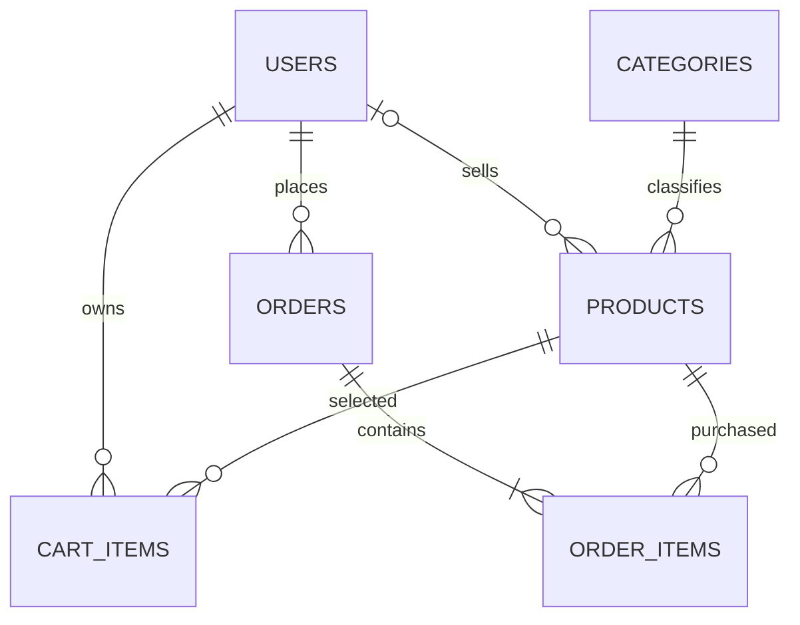

# Database schema

The SQLite schema is maintained in `server/database/schema.sql`; idempotent sample data is in `server/database/seed.sql`. The database uses foreign keys and parameterized statements. Prices are stored as whole INR rupees in integer columns.

## Tables

- `users`: unique email, bcrypt password hash, role (`customer`, `seller`, or `admin`), timestamps.
- `categories`: unique category name and timestamps.
- `products`: category, nullable seller owner, name/description, integer price, non-negative stock, optional `image_url` (HTTP(S) URL or same-origin `/images/products/*.svg` asset path), active flag, timestamps.
- `cart_items`: user/product foreign keys, positive quantity, unique `(user_id, product_id)`.
- `orders`: customer and delivery fields, COD method, constrained status, server-calculated total, timestamps.
- `order_items`: order/product foreign keys, product-name snapshot, quantity, purchase-time unit price, and line total.

## Relationships

Deleting products is a soft deactivation so order history retains its product references. Categories with products cannot be deleted. Existing products without an owner remain unassigned and are manageable by administrators; the migration does not assign them to an arbitrary seller. Seed products resolve their sample seller by email rather than assuming a user ID.

## Checkout consistency

Checkout uses a process-wide transaction queue and `BEGIN IMMEDIATE`. The service re-reads current cart rows and prices inside the transaction, validates active status and stock, records order-item price snapshots, decrements stock conditionally, removes cart rows, and commits. Any failure rolls back all those changes.

## Startup migration

Initialization applies the schema, safely expands the user role constraint and product columns when needed, and repairs legacy foreign keys that pointed to `users_legacy`. It copies existing user, cart, order, and product rows rather than deleting or recreating the database. For the exact known sample product ID/name pairs, startup fills the local illustration path only when `image_url` is empty; existing custom image values are preserved. The integration test starts from a populated legacy fixture and checks preserved rows and `PRAGMA foreign_key_check`.
